[](https://www.linkedin.com/in/pedro-bull-0363ba1a1/)
[](https://www.python.org/)

# Previsão de Vendas Futuras - E-commerce brasileiro

O marketplace Olist, um dos maiores do Brasil, precisa de um modelo de previsão de vendas para melhorar seus processos logísticos e planejamento financeiro à curto e médio prazo. Para isso, dispõe de diversas bases de dados com informações sobre pedidos, avaliações de clientes, vendedores cadastrados, geolocalização de usuários e sellers, informações sobre produtos e vendas históricas.

Neste projeto, diferentes modelos de previsão, tanto de estatística clássica quanto de machine learning, são implementados e comparados para escolher o mais adequado ao problema.


[Link original para o dataset](https://www.kaggle.com/datasets/olistbr/brazilian-ecommerce)

<p align="center"> 
  <a href="https://www.linkedin.com/in/pedro-bull-0363ba1a1/" target="_blank"></a> 
</p>

## Objetivos

O objetivo deste projeto é, partindo do conjunto de dados fornecidos pela empresa, construir um processo de ETL para criar uma série histórica de vendas diárias e, em seguida, aplicar técnicas de ciência de dados para prever o total de unidades vendidas nas 4 semanas seguintes. Com isso, é possível otimizar o planejamento logístico e financeiro no curto prazo, trazendo resultados consistentes e confiáveis sobre a tendência do que deve acontecer com as vendas da empresa.

Para isso, foram implementados e comparados seis modelos de previsão:

- **Seasonal Naive**: modelo de referência (baseline), que repete as vendas da última semana.
- **ARIMA**, **SARIMA** e **SARIMAX**: modelos estatísticos clássicos de séries temporais.
- **XGBoost** e **LightGBM**: modelos de machine learning baseados em árvores de decisão (gradient boosting).

Por fim, o modelo escolhido foi organizado em um pipeline de código Python, simulando a forma como o modelo seria colocado em produção, com retreino e monitoramento semanais.


## Estrutura do repositório

O repositório está estruturado da seguinte forma:

```
├── data
├── images
├── models
├── notebooks
├── outputs
├── reports
├── src
├── tests
```

- Na pasta `data` estão os dados utilizados no projeto: os arquivos originais fornecidos pela empresa (`olist_*.csv`) e as bases geradas durante o projeto, salvas para fins de organização e versionamento. A base de vendas construída a partir dos arquivos originais é a `sales_db_01.csv`, a série de vendas diárias é a `sales_ts_daily.csv`, e as bases finais para alimentar os modelos são a `sales_db_03_ts.csv` (modelos de séries temporais) e a `sales_db_03_ml.csv` (modelos de machine learning).
- Na pasta `images` estão as imagens utilizadas neste README.
- Na pasta `models` estão as configurações escolhidas na etapa de modelagem (`model_configs.json`) e o modelo final treinado pelo pipeline (`modelo_final.pkl`), com as suas informações (`modelo_final.json`).
- Na pasta `notebooks` estão os notebooks com o desenvolvimento do projeto. Em detalhes, temos:
  - [`01_sales_pred_db_creation.ipynb`](notebooks/01_sales_pred_db_creation.ipynb): notebook com a construção da base de dados inicial.
  - [`02_sales_pred_eda.ipynb`](notebooks/02_sales_pred_eda.ipynb): notebook com as etapas de data cleaning e análise exploratória dos dados usando [ydata-profiling](https://github.com/ydataai/ydata-profiling) e Seaborn, incluindo a análise de séries temporais.
  - [`03_sales_pred_feature_eng.ipynb`](notebooks/03_sales_pred_feature_eng.ipynb): notebook com a aplicação de engenharia de recursos para ajuste dos dados antes de fornecê-los aos modelos.
  - [`04_sales_pred_model.ipynb`](notebooks/04_sales_pred_model.ipynb): notebook com a criação e a comparação dos modelos de previsão.
  - [`05_sales_pred_model_validation.ipynb`](notebooks/05_sales_pred_model_validation.ipynb): notebook com a etapa de validação dos modelos com dados não vistos.
- Na pasta `outputs` estão os resultados gerados pelo pipeline: relatórios de comparação dos modelos, previsões e monitoramento.
- Na pasta `reports` estão os relatórios gerados durante o projeto utilizando a biblioteca [ydata-profiling](https://github.com/ydataai/ydata-profiling).
- Na pasta `src` estão os códigos Python executáveis do projeto, para uso em produção.
- Na pasta `tests` estão os testes automatizados do pipeline.

Todo o raciocínio do projeto foi desenvolvido nos notebooks, para facilitar o entendimento de cada decisão tomada. A pasta `src` contém o mesmo processo reorganizado em módulos Python, prontos para serem executados de forma automática em um ambiente de produção, conforme detalhado na seção [Pipeline de produção](#pipeline-de-produção).

As bases de dados originais fornecidas pela empresa estão estruturadas conforme a imagem abaixo. Esses arquivos podem ser baixados através do [link original para o dataset](https://www.kaggle.com/datasets/olistbr/brazilian-ecommerce). A partir desses dados, a base inicial para o projeto foi construída conforme detalhado no notebook [`01_sales_pred_db_creation`](notebooks/01_sales_pred_db_creation.ipynb).

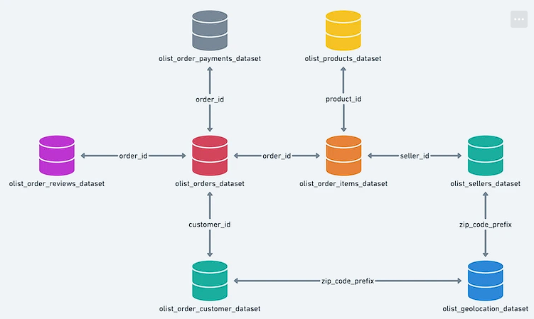


## Etapa 1 - Construção da base de dados

A base de dados [`sales_db_01.csv`](data/sales_db_01.csv) foi agrupada de forma que cada linha represente um produto vendido. Ou seja, para pedidos com mais de um produto, por exemplo, o código de identificação do pedido é o mesmo para cada um dos produtos comprados. Foram considerados somente os pedidos entregues, que representam mais de 97% dos pedidos, e a data da compra foi adotada como a data da venda. A base contém os seguintes dados:

- `sale_date`: Data da venda
- `order_id`: Código de identificação do pedido
- `customer_id`: Código de identificação do cliente
- `product_id`: Código de identificação do produto do pedido
- `product_category_name`: Categoria do Produto
- `product_description_lenght`: Número de caracteres na descrição do anúncio do produto
- `order_units`: Unidades do produto no pedido
- `unit_price`: Preço unitário do produto
- `zip_code_prefix`: Prefixo do CEP do cliente
- `customer_state`: UF de destino do pedido


## Etapa 2 - Data Cleaning e Análise Exploratória

Após a limpeza e correção dos dados, foi gerado um relatório preliminar com o [ydata-profiling](https://github.com/ydataai/ydata-profiling). A figura abaixo mostra o comportamento histórico das vendas:

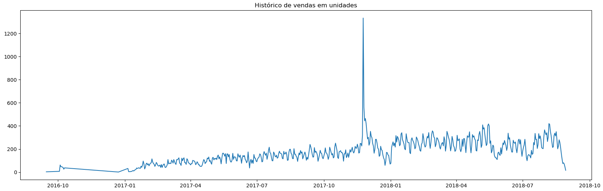

Em seguida, a correlação das variáveis foi avaliada em pares com o gráfico de pairplot. Para essa análise, o objetivo é entender, com os gráficos de dispersão, como cada par de variáveis está relacionado. Além disso, foi gerada uma tabela para avaliar a cardinalidade (número de valores distintos) de cada uma das colunas.

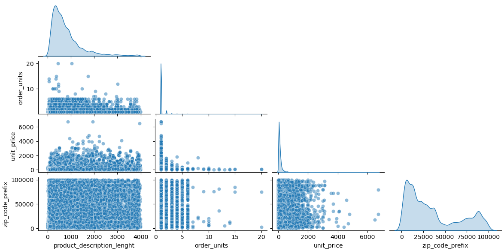

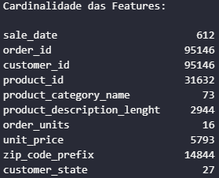

Após as análises, as seguintes conclusões foram tomadas:

- Avaliando a cardinalidade das colunas (número de valores distintos), temos que as colunas de order_id, customer_id e product_id são números de identificação específicos para cada pedido. Esse tipo de informação não agrega valor à análise e, por isso, as colunas serão desconsideradas;
- Avaliando o pairplot, temos que a coluna de product_description_lenght não tem correlação relevante com o número de unidades vendidas. Assim, essa coluna será excluída;
- A coluna de zip_code_prefix também será excluída para evitar duplicidade de informações, já que a região de venda é representada pela coluna customer_state.

Por fim, foram utilizados gráficos de boxplot para avaliar tanto a distribuição estatística dos dados quanto a existência de outliers.

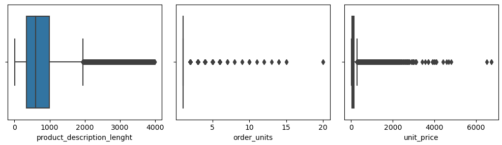

Avaliando especificamente a coluna target ('order_units'), temos:

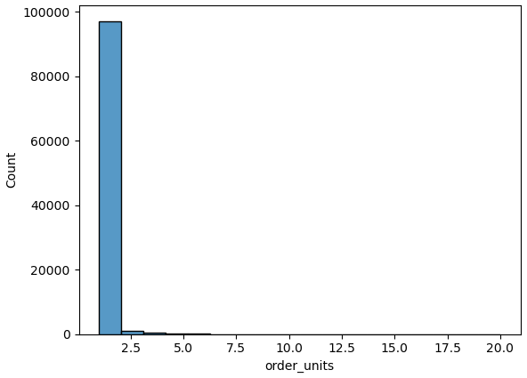

De fato existem poucos registros de vendas de mais de uma unidade no mesmo pedido. Porém, esses dados serão mantidos, já que não existe um padrão claro para a venda de mais unidades de um produto por pedido e, ao que tudo indica, é apenas a representação da dinâmica de vendas de determinados produtos.

### Análise de séries temporais

Como o objetivo do projeto é prever o total de unidades vendidas por dia, os dados também foram avaliados como uma série temporal, ou seja, uma única sequência contínua de vendas diárias.

O primeiro ponto avaliado foi o período útil da série. Os registros de 2016 são esparsos (novembro não tem nenhuma venda e dezembro tem apenas um pedido), por isso a série foi iniciada em 05/01/2017, quando as vendas passam a ser contínuas. No fim da base, as vendas caem bruscamente a partir de 21/08/2018. Essa queda não representa um comportamento real de vendas, já que os pedidos desses últimos dias estão incompletos na base disponibilizada pela empresa. Assim, a série foi cortada em 19/08/2018, um domingo, para que a última semana fique completa.

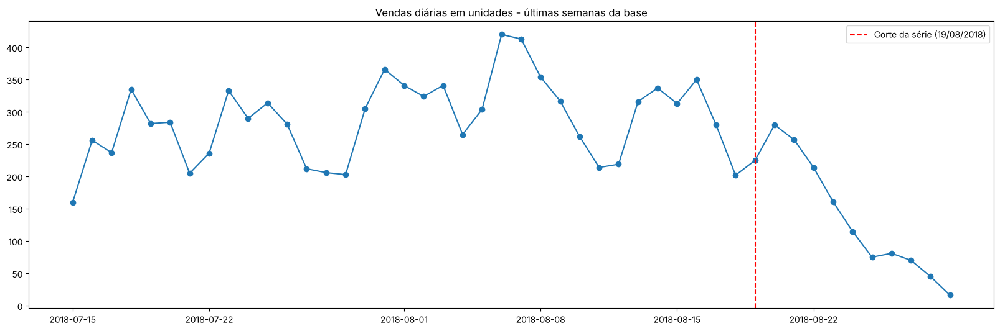

No período útil, a série apresenta uma tendência de crescimento ao longo de 2017, que se estabiliza em 2018 em torno de 250 a 300 unidades por dia. A Black Friday de 2017 aparece como o maior pico de vendas, e existem duas quedas pontuais relevantes: no período de festas de fim de ano e no fim de maio de 2018, durante a greve dos caminhoneiros.

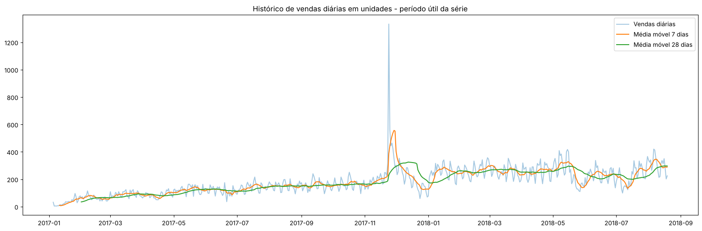

Existe também uma sazonalidade semanal clara: as vendas são maiores de segunda a quarta-feira, caem gradualmente até sexta e atingem o menor nível no sábado. Em 2018, a média do fim de semana ficou cerca de 27% abaixo da média dos dias úteis.

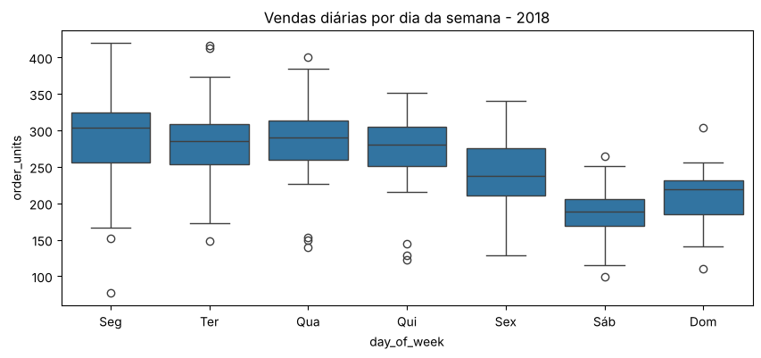

A decomposição STL separa a série em tendência, sazonalidade semanal e resíduo. É possível perceber que a amplitude da sazonalidade cresce junto com o nível de vendas, o que indica uma sazonalidade multiplicativa. Por isso, a transformação logarítmica das vendas foi testada na etapa de modelagem.

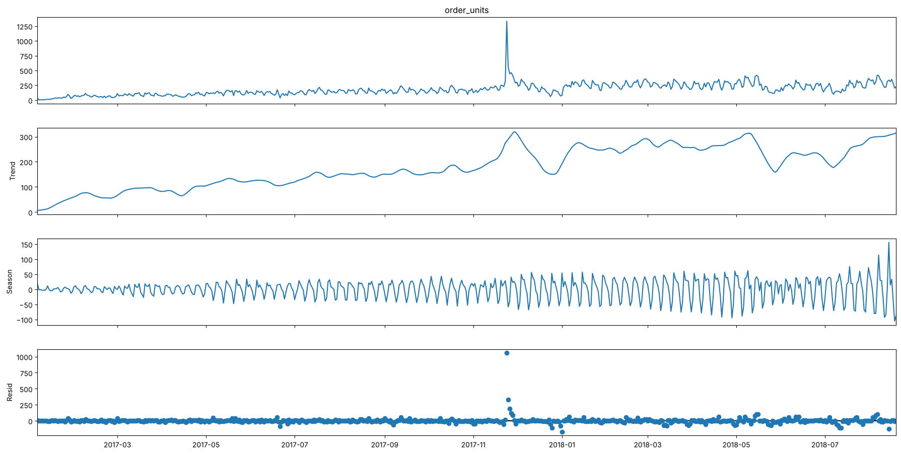

Por fim, os testes de estacionariedade (ADF e KPSS) indicaram que a série original não é estacionária, mas que uma diferenciação é suficiente para torná-la estacionária. A análise da autocorrelação (ACF) e da autocorrelação parcial (PACF) da série diferenciada indicou o modelo SARIMA(0,1,1)(0,1,1)7 como ponto de partida para a modelagem.

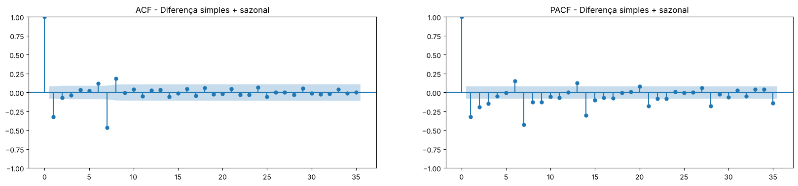

Com o histórico de pouco mais de 19 meses, a Black Friday aparece uma única vez na série, e não é possível estimar uma sazonalidade anual. Por isso, esses eventos foram tratados como variáveis indicadoras na etapa de Feature Engineering.


## Etapa 3 - Feature Engineering

Após o completo entendimento dos dados, na etapa 3 foram feitos os ajustes necessários para preparar a série de vendas diárias para os dois grupos de modelos do projeto: os modelos estatísticos de séries temporais, que trabalham diretamente com a sequência histórica de vendas, e os modelos de machine learning, que precisam que a informação temporal seja transformada em colunas (features).

O primeiro passo foi definir o horizonte de previsão e a divisão da base. O horizonte adotado é de **28 dias** (4 semanas completas), que atende ao objetivo de apoiar o planejamento de curto prazo. A base foi dividida respeitando a ordem cronológica, sem embaralhar os dados:

- **Treino**: todo o histórico até 24/06/2018.
- **Validação**: de 25/06/2018 a 22/07/2018, utilizada para escolher as configurações de cada modelo.
- **Teste**: as últimas 4 semanas da série (23/07/2018 a 19/08/2018), separadas para simular o ambiente de produção e utilizadas somente ao final do projeto.

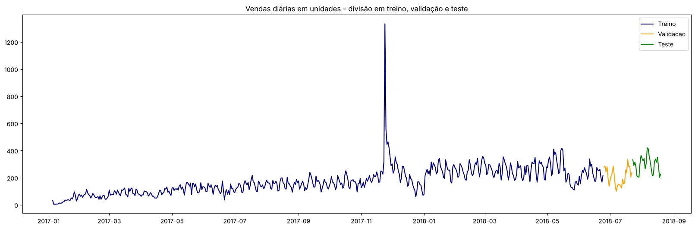

Em seguida, foram criadas as variáveis de eventos identificados na análise exploratória, comuns aos dois grupos de modelos: feriados nacionais (obtidos pela biblioteca [holidays](https://github.com/vacanza/holidays)), Black Friday, dias seguintes à Black Friday, festas de fim de ano e greve dos caminhoneiros. Essas variáveis indicam aos modelos que esses dias são exceções, evitando que os picos e as quedas distorçam a tendência e a sazonalidade aprendidas.

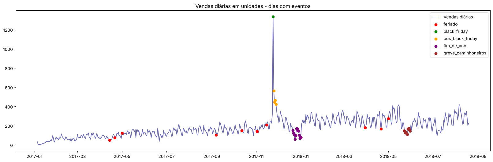

Para os **modelos de séries temporais**, foi aplicada a transformação logarítmica nas vendas, que estabiliza a variação da sazonalidade semanal, e as variáveis de eventos foram preparadas como variáveis exógenas.

Para os **modelos de machine learning**, foram criadas features de calendário (mês, dia da semana e dia do mês) e features de vendas passadas. Como a previsão é feita de uma vez para os próximos 28 dias, todas as features de vendas passadas utilizam somente valores de 28 dias atrás ou mais:

- `lag_28`, `lag_35` e `lag_42`: vendas no mesmo dia da semana, 4, 5 e 6 semanas antes.
- `rolling_mean_7_lag28` e `rolling_mean_28_lag28`: médias das vendas nos 7 e nos 28 dias encerrados 28 dias antes.

Dessa forma, nenhuma feature utiliza informações do período que está sendo previsto. Para confirmar isso, as features foram calculadas novamente com as vendas do período de teste apagadas, e os valores foram exatamente os mesmos.


## Etapa 4 - Criando os Modelos

Na etapa de criação dos modelos, os seis modelos descritos nos objetivos foram implementados e avaliados com o mesmo esquema de validação e as mesmas métricas, o que permite compará-los de forma justa.

Em séries temporais, a validação cruzada tradicional (com embaralhamento dos dados) não é adequada, porque o modelo seria treinado com dados posteriores aos que está prevendo. Por isso, foi adotada a **validação com origem móvel** (backtest): os modelos foram avaliados em 4 janelas consecutivas de 28 dias e, em cada janela, foram treinados com todo o histórico anterior ao início da janela. O resultado final de cada modelo é a média das 4 janelas.

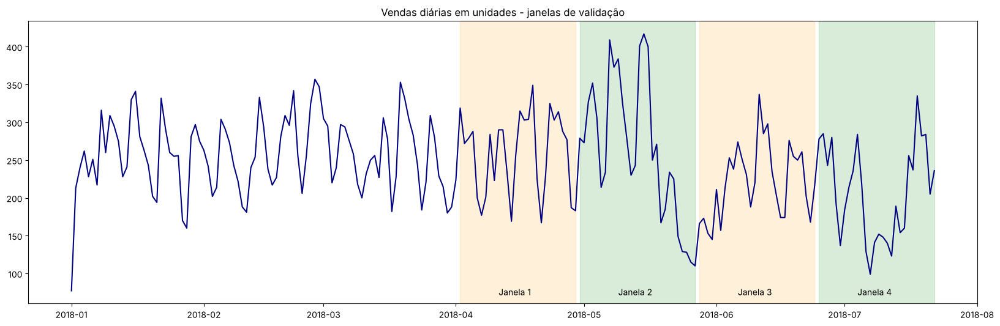

A principal métrica analisada foi o **WMAPE** (erro percentual absoluto médio ponderado), que corresponde à soma dos erros absolutos dividida pela soma das vendas reais. Por ser em percentual, ele é fácil de interpretar pela área de negócio e, diferente do MAPE, não distorce o resultado em dias com vendas baixas. Também foram avaliados o MAE, o RMSE e o erro no total previsto para as 4 semanas.

As principais decisões em cada modelo foram:

- **ARIMA e SARIMA**: as ordens dos modelos foram escolhidas pelo critério de informação de Akaike (AIC), com os dados anteriores à primeira janela de validação. O SARIMA escolhido foi o SARIMA(1,1,1)(0,1,1)7, muito próximo do ponto de partida indicado pela análise exploratória.
- **SARIMAX**: utiliza as mesmas ordens do SARIMA, com as variáveis de eventos como variáveis exógenas.
- **XGBoost e LightGBM**: os hiperparâmetros `max_depth` e `n_estimators` foram escolhidos por uma busca simples, avaliada pelo WMAPE médio do backtest.

Os resultados obtidos foram os seguintes:

| Modelo | MAE | RMSE | WMAPE (%) | Melhoria vs baseline |
|---|---|---|---|---|
| **SARIMAX** | **44,0** | **55,5** | **18,6** | **23,0%** |
| XGBoost | 48,7 | 61,1 | 20,6 | 14,6% |
| LightGBM | 53,1 | 65,2 | 22,7 | 6,2% |
| Seasonal Naive | 56,8 | 68,5 | 24,2 | - |
| SARIMA | 58,8 | 68,9 | 25,2 | -4,5% |
| ARIMA | 74,4 | 86,9 | 31,5 | -30,5% |

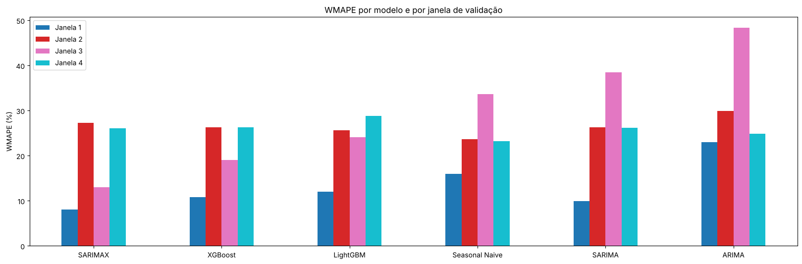

O **SARIMAX** foi o melhor modelo, com WMAPE médio de 18,6% e uma melhoria de 23% em relação ao baseline. A decisão com maior impacto no resultado foi a inclusão das variáveis de eventos: na janela 3, logo após a greve dos caminhoneiros, o erro caiu de 38,5% no SARIMA para 13,0% no SARIMAX, já que o modelo passou a entender a queda da greve como uma exceção, e não como um novo nível de vendas.

As janelas 2 e 4 foram difíceis para todos os modelos, por conterem eventos que não estão representados nos dados: um pico de vendas em meados de maio, a greve e as semanas finais da Copa do Mundo de 2018.

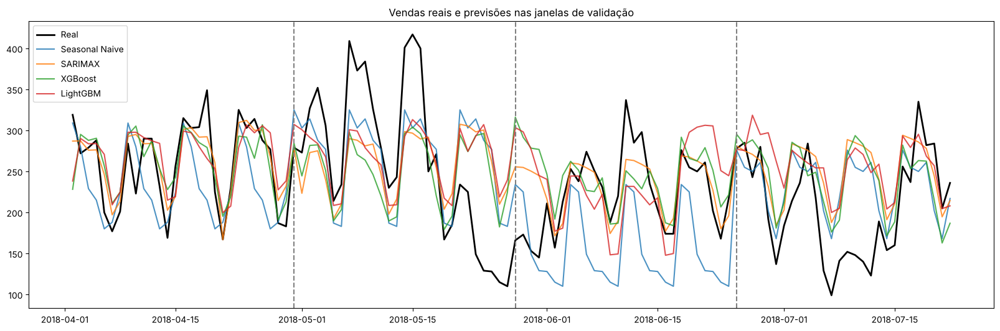

É importante destacar que, se apenas a janela de validação (25/06/2018 a 22/07/2018) fosse utilizada, o Seasonal Naive teria o menor erro entre os modelos e a conclusão seria diferente. Isso mostra a importância de avaliar os modelos em mais de um período.


## Etapa 5 - Simulando o ambiente de produção para validação do modelo

Na última etapa, todos os modelos foram treinados novamente com todo o histórico até 22/07/2018 e fizeram a previsão das 4 semanas da base de teste, que não foi utilizada em nenhuma etapa anterior. Essa é uma forma de simular uma previsão real feita naquela data. As configurações dos modelos não foram alteradas, já que a base de teste serve para confirmar a escolha feita na etapa 4.

| Modelo | MAE | RMSE | WMAPE (%) | Erro no total das 4 semanas |
|---|---|---|---|---|
| **SARIMAX** | **29,2** | **37,0** | **9,8** | **-1,8%** |
| SARIMA | 29,6 | 38,1 | 10,0 | -3,3% |
| Seasonal Naive | 49,3 | 67,3 | 16,6 | -11,6% |
| LightGBM | 52,7 | 62,4 | 17,8 | -17,1% |
| ARIMA | 56,7 | 68,3 | 19,1 | -13,0% |
| XGBoost | 67,8 | 77,4 | 22,9 | -22,2% |

O SARIMAX confirmou o melhor desempenho, com WMAPE de 9,8% e erro de apenas -1,8% no total das 4 semanas.

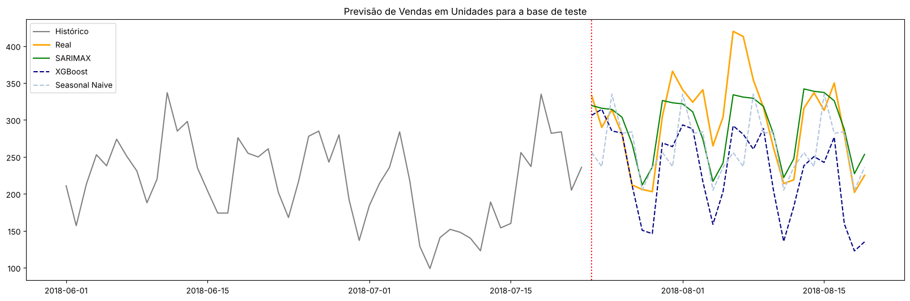

Os modelos de machine learning subestimaram as vendas durante todo o período de teste. Como as features de vendas passadas utilizam defasagem mínima de 28 dias, elas foram calculadas com as vendas das semanas da Copa do Mundo, quando as vendas ficaram abaixo do padrão. Já o SARIMAX dá mais peso às observações mais recentes e captou a recuperação das vendas na última semana do histórico.

Além da previsão, o SARIMAX também fornece intervalos de previsão, que podem ser utilizados como cenários pessimista e otimista no planejamento. Todas as vendas do período de teste ficaram dentro do intervalo de 80%.

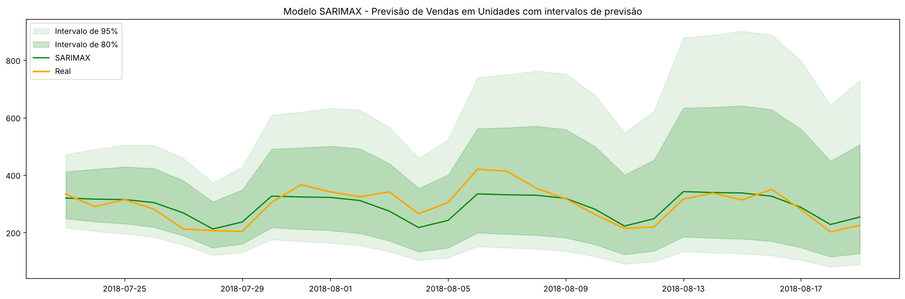

Agrupando os resultados por semana, é possível validar que o modelo obteve uma ótima performance para aplicações de planejamento: o WMAPE cai para 7,1%, e o total previsto para as 4 semanas foi de 8.159 unidades, contra 8.307 vendidas.

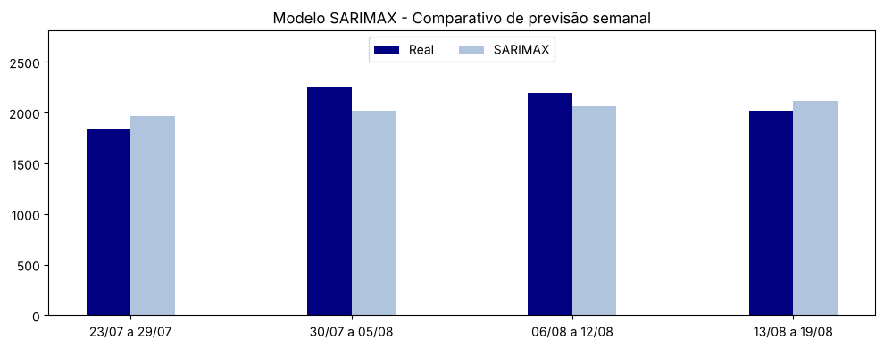

Considerando também os resultados do backtest, a expectativa para o uso do modelo em produção é de erros diários em torno de 10% em períodos normais, podendo superar 25% em períodos com eventos não previstos.


## Pipeline de produção

Após o desenvolvimento nos notebooks, o processo foi organizado em módulos Python na pasta `src`, de forma que possa ser executado de forma automática, sem a necessidade de rodar os notebooks:

```
src
├── config.py               # caminhos, período da série, horizonte e eventos
├── data.py                 # construção da série de vendas diárias a partir dos arquivos originais
├── features.py             # variáveis de eventos e features dos modelos
├── models.py               # modelos com uma interface comum de treino e previsão
├── evaluation.py           # métricas e validação com origem móvel
├── train.py                # compara os modelos, escolhe o melhor e salva o modelo final
├── predict.py              # gera a previsão das próximas 4 semanas
└── simulate_production.py  # simula o uso do modelo com retreino e monitoramento semanais
```

As variáveis de eventos são calculadas por regras de calendário (a Black Friday, por exemplo, é sempre a sexta-feira seguinte à quarta quinta-feira de novembro), o que permite gerar os eventos para qualquer ano futuro. Eventos não planejados, como a greve dos caminhoneiros, são utilizados apenas no treino, já que não são conhecidos no momento da previsão.

A cada treino, o pipeline executa o backtest de todos os modelos e escolhe automaticamente o modelo com o menor WMAPE. Com os dados até 22/07/2018, o pipeline reproduz exatamente os resultados da etapa 4.

Para simular o uso do modelo em produção, o modelo foi retreinado semanalmente entre abril e agosto de 2018. A cada semana, as vendas reais foram comparadas com a previsão e um alerta foi gerado sempre que o WMAPE da semana passou de 25%. Os 4 alertas gerados aconteceram exatamente nas semanas da greve dos caminhoneiros e da Copa do Mundo, mostrando que o monitoramento identifica os períodos em que eventos não previstos afetam as vendas.

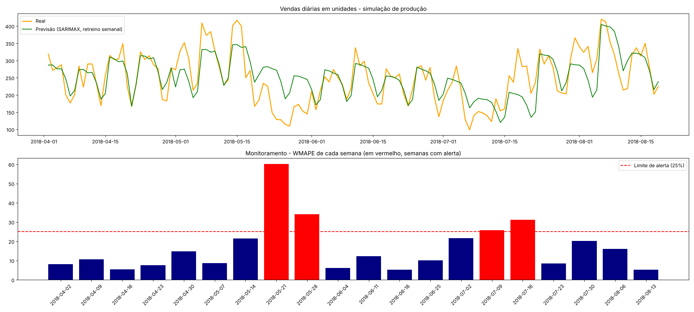

Além disso, a pasta `tests` contém testes automatizados que garantem, entre outros pontos, que as features e as previsões dos modelos não utilizam informações do período previsto.


## Conclusões

- O **SARIMAX(1,1,1)(0,1,1)7 com variáveis de eventos** foi o melhor modelo tanto na validação (WMAPE médio de 18,6%) quanto na base de teste (WMAPE de 9,8%), e foi escolhido como o modelo final do projeto.
- Com menos de dois anos de histórico, os modelos estatísticos foram mais precisos e mais estáveis que os modelos de machine learning, que dependem de features com defasagem de 28 dias e demoram a reagir a mudanças no nível de vendas.
- As decisões com maior impacto no resultado foram modelar a sazonalidade semanal e, principalmente, incluir as variáveis de eventos.
- Os maiores erros vieram de eventos que não estão representados nos dados, como promoções e grandes eventos esportivos.

Como próximos passos, temos:

- Incluir novos eventos como variáveis, como campanhas promocionais e grandes eventos esportivos.
- Com mais histórico, incluir a sazonalidade anual e reavaliar os modelos de machine learning, inclusive com a previsão recursiva.
- Aplicar o pipeline a séries por categoria de produto ou por estado, apoiando o planejamento de estoques e de logística em cada segmento.


## Como executar

O projeto foi desenvolvido com Python 3.13. Para executar, crie um ambiente virtual e instale as dependências:

```bash
python -m venv .venv
.venv\Scripts\activate          # Windows (no Mac/Linux: source .venv/bin/activate)
pip install -r requirements.txt
```

Os notebooks podem ser executados na ordem da pasta `notebooks`. Para executar o pipeline, a partir da pasta raiz do projeto:

```bash
python -m src.train                    # compara os modelos e salva o modelo final
python -m src.predict                  # gera a previsão das próximas 4 semanas
python -m src.simulate_production      # simula o uso do modelo com retreino e monitoramento semanais
python -m pytest tests                 # executa os testes automatizados
```

Os dados utilizados pertencem à [Olist](https://www.kaggle.com/datasets/olistbr/brazilian-ecommerce) e são disponibilizados sob a licença [CC BY-NC-SA 4.0](https://creativecommons.org/licenses/by-nc-sa/4.0/).
